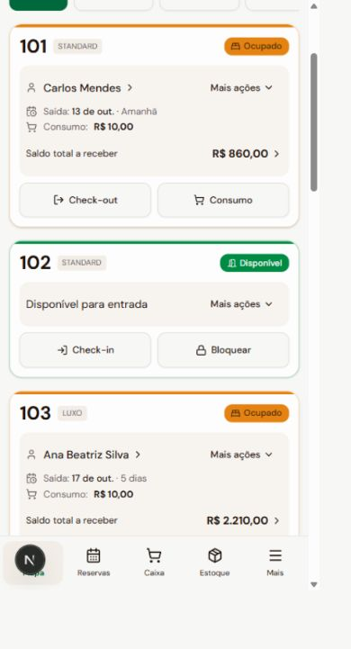

# Ações dos quartos e prorrogação

Entrega: 12/10/2026. Implementação do [plano de ações contextuais](PLANO_ACOES_DOS_QUARTOS.md).

## Uso no mapa

Os atalhos principais permanecem: **Check-out / Consumo**, **Check-in / Bloquear**, **Liberar quarto** e **Desbloquear quarto**, conforme a situação e as permissões.

O nome do hóspede abre o atendimento com o extrato. O saldo abre o recebimento diretamente. **Mais ações** reúne recebimento, extrato, prorrogação, troca de quarto e ocupantes, abrindo cada tarefa no contexto escolhido. Funções adicionais não criam novas linhas de botões no cartão.

O menu mostra somente ações autorizadas e pertinentes. Quando o saldo está quitado, o recebimento deixa de aparecer. Uma hospedagem moderna inclui diárias e consumo no saldo uma única vez; reservas legadas exibem **Diárias a receber** para não apresentar esse valor como saldo completo. Ocupações ambíguas bloqueiam operações até a regularização.

Os cartões acompanham a altura do conteúdo e ficam alinhados pelo topo. O calendário do desktop permanece disponível. No celular, o atendimento ocupa a largura da tela, e o menu respeita os limites do visor. A seleção fecha o menu antes de abrir a tarefa; o foco acompanha o atendimento e retorna ao cartão ao fechar.

Durante uma operação, os controles evitam submissões repetidas. Formulários alterados pedem confirmação antes de descartar dados. Uma falha conserva os campos para correção e nova tentativa.

## Prorrogar uma hospedagem

1. Abra **Mais ações → Prorrogar estadia** no quarto ocupado.
2. Escolha uma saída posterior à saída atual e à data de hoje.
3. Confira as noites adicionais, os valores, a disponibilidade e informe o motivo.
4. Marque a confirmação do valor revisado e confirme a prorrogação.

As novas noites usam o quarto atual, a quantidade de hóspedes e as tarifas vigentes. As diárias anteriores, descontos, pagamentos e consumos permanecem preservados. Para uma estadia atrasada, o período adicional começa na saída anteriormente registrada. Prorrogar não registra pagamento.

A operação exige quantidade de hóspedes conhecida e composição das diárias anteriores. Cadastros legados sem esses dados precisam ser regularizados; o sistema não estima preços silenciosamente. A troca de quarto e a edição de ocupantes continuam disponíveis quando a ocupação é conhecida, mesmo sem composição antiga das diárias. Estadias encerradas não podem ser prorrogadas.

O servidor verifica novamente o estado da hospedagem, a ocupação do quarto, as reservas conflitantes, a capacidade, as tarifas e a versão do registro. Alterações de tarifa exigem nova confirmação mesmo quando o preço final permanece igual. Uma reserva começando exatamente na nova saída não constitui sobreposição.

Estadia, reserva, período de ocupação e quarto são atualizados na mesma transação. Duas prorrogações concorrentes não aplicam a mesma alteração; uma nova reserva concorrente também não pode ocupar o período prorrogado. A repetição da mesma solicitação confirmada não duplica diárias, auditoria ou notificações.

A base original da reserva aumenta pelas novas diárias, preservando o cálculo do teto de desconto acumulado. A auditoria registra saída anterior, nova saída, motivo e acréscimo; a central recebe o evento de prorrogação. As regras existentes de quitação e saída com cobrança empresarial permanecem aplicáveis ao check-out.

A reserva em check-in não oferece edição genérica: suas alterações operacionais são feitas pelo atendimento da hospedagem.

## Acesso

A ação exige **Prorrogar estadia** (`hospitality.extend`) e consulta de hospedagens, quartos e tarifas. Administrador, supervisor, recepção e operador legado recebem a permissão nos perfis iniciais. Perfis personalizados exigem concessão explícita. O servidor aplica a regra inclusive ao consultar resultados de solicitações já confirmadas após revogação do acesso.

## Arquitetura

- `lib/room-actions.ts`: resolve as ações pelo estado e pelas permissões.
- `components/room-actions-menu.tsx`: menu contextual com foco e fechamento coordenados.
- `components/room-card.tsx`: resumo e atalhos, com uma tarefa aberta por vez.
- `components/stay-sheet.tsx`: atendimento contextual, formulários e revisão da prorrogação.
- `lib/stay-extension.ts`: validação e assinatura da composição de preço.
- `lib/server/stays.ts`: alteração transacional, disponibilidade e proteção contra concorrência.
- `lib/data/demo-stays.ts`: comportamento equivalente para os exemplos locais.

Foram reutilizadas a autorização, a transação serializável, a idempotência, a auditoria, a sincronização e a central de notificações existentes. Não há novos serviços ou bibliotecas para operar.

## Validação

- 407 testes de unidade e componentes em 61 arquivos aprovados.
- 204 testes de integração em 21 arquivos aprovados, usando PostgreSQL isolado.
- Após o ajuste final da base de desconto, 57 testes de integração de prorrogação, hospedagem e segurança foram repetidos e aprovados.
- Verificação de tipos, lint e compilação de produção aprovados.
- Interface real conferida em larguras de 320, 390 e 768 pixels, sem rolagem horizontal; menu, fechamento por Escape, abertura direta do check-out e foco do atendimento verificados.

Os testes não alteraram o banco operacional da pousada.

## Atualizar a instalação

No painel, utilize **Mais opções → Atualizar versão** para reconstruir a aplicação com o código atual. Uma imagem Docker antiga continuará exibindo a interface anterior. Ao recriar os exemplos da demonstração, confira a confirmação de descarte das alterações temporárias.
